

  

<h1 align="center">APEX ORV</h1>

  <b>The offline trail map for Michigan.</b> 
  ORV routes, trails, forest roads, rivers, public land and campgrounds on both peninsulas. Turn-by-turn, with no signal.

  

  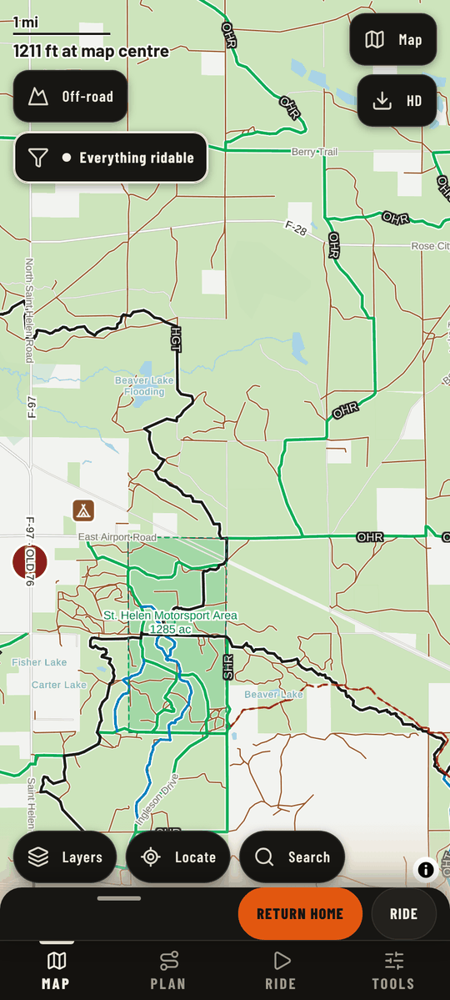
  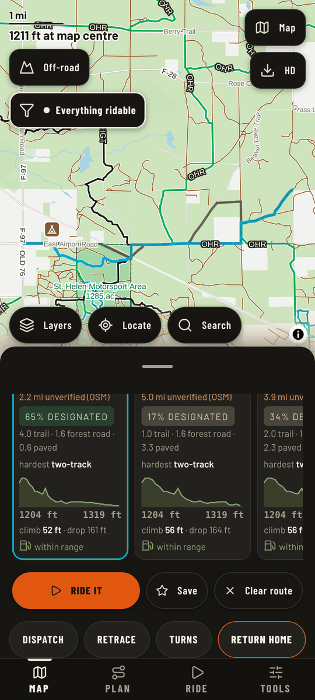
  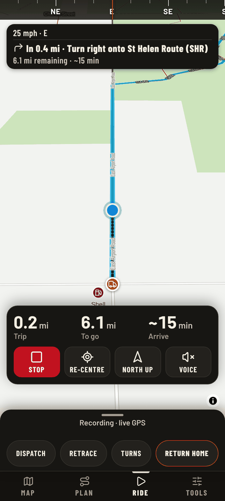
  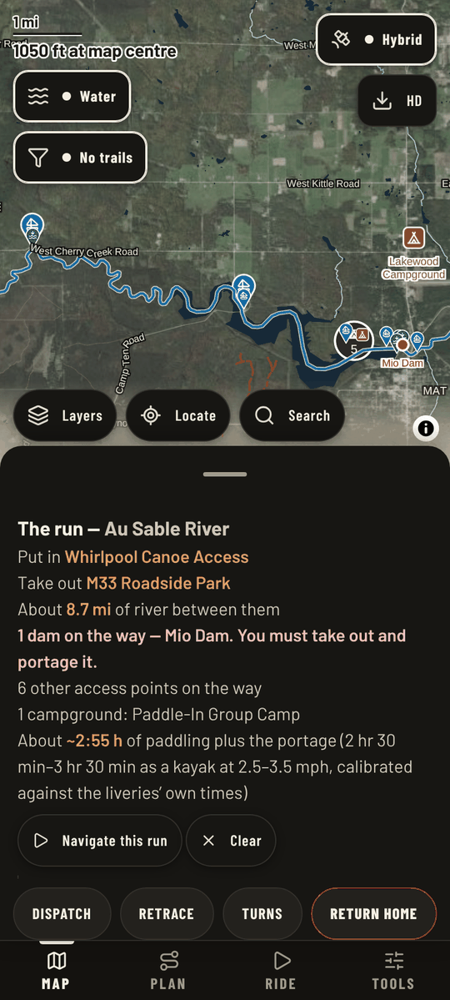

- **Fully offline:** maps, routing, satellite imagery, search and photos are on the phone.
- **Legal routing:** routes only on lines your machine may ride, by DNR and Forest Service designations; OpenStreetMap roads and two-tracks fill the gaps and are marked unverified.
- **Free:** no account, no ads, no tracking. Android 8.0+.

## Quick start

1. Pick a **mode** (chip, top left).
2. **Tap** a trail, road, pin or public land for its card.
3. **Press and hold** a spot → **Route here** → **Ride it**.
4. Set **Home** (Plan tab); **Return home** is then one tap.

Tabs: **Map** (layers, search, locate) · **Plan** (machine, home, fuel, loops, saved) · **Ride** · **Tools**.

## Five modes

One chip sets the pins, lines and routing. Anything hidden is a tap away in **Layers** or the **trail filter** (ORV, two-track, hiking, horse, snowmobile…), which doubles as the legend.

  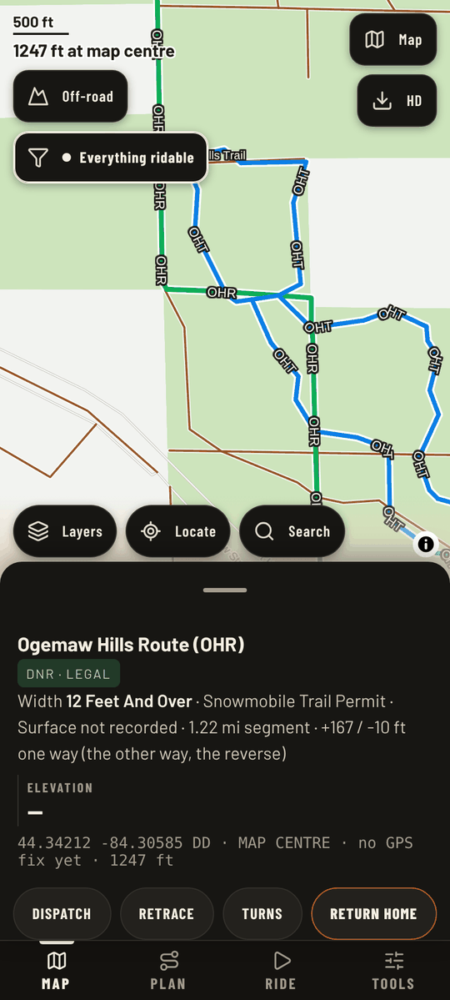
  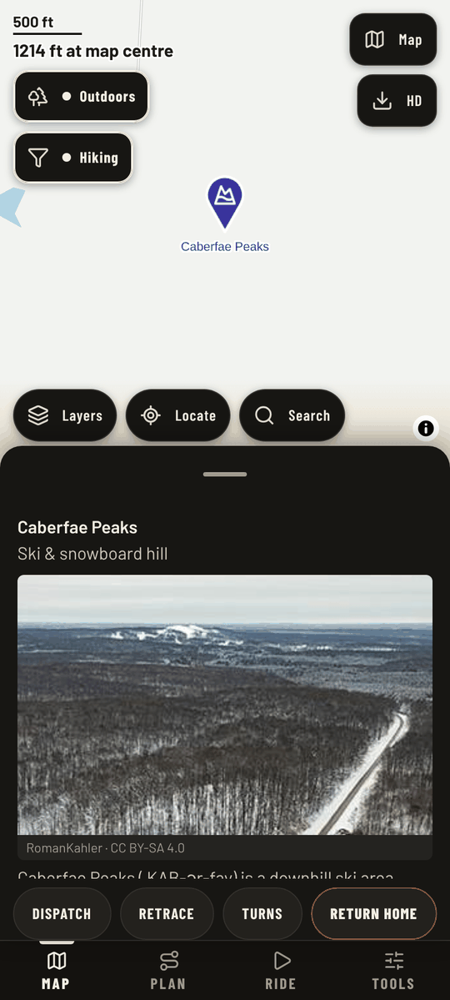
  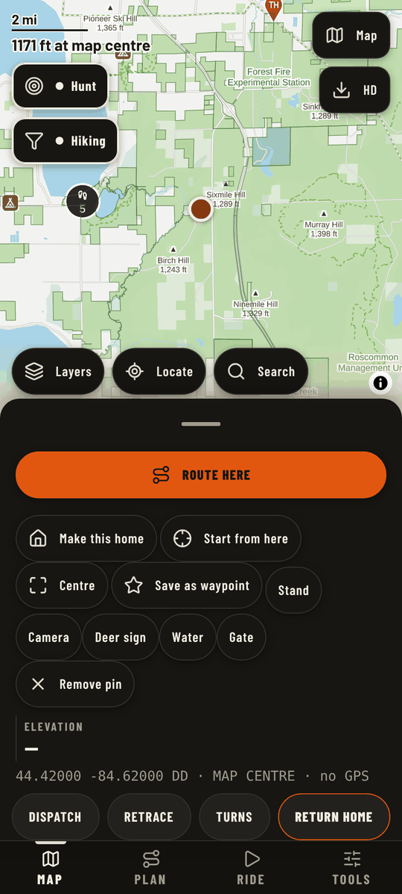
  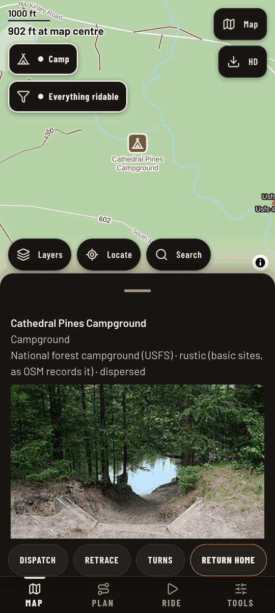

- **Off-road:** ORV, dirt bike, quad, side-by-side, MTB
  - Difficulty colors: green 72" route, blue 50" trail, black 24" trail, red closed
  - Machine picker (24" / 50" / 72"): trails too narrow for yours fade
  - Riding areas (St. Helen, Silver Lake Dunes…) drawn as open ground
  - Hiking, horse and snowmobile trails shown, never routed for a machine
  - Trailheads, fuel, campgrounds
- **Outdoors:** hike, fish, explore, on foot
  - Hiking and MTB trail systems, named hills with heights, rivers
  - Ski hills: runs by name and difficulty (never guessed)
- **Hunt:** on foot
  - 4.7 million acres of state land with boundaries; county lines
  - Long-press to save a stand, camera, deer sign, water or gate
- **Water:** no trail lines
  - Launches (OpenStreetMap + DNR sites), liveries, beaches, marinas, lighthouses
  - River run planner ([below](#on-the-water))
- **Camp**
  - Campgrounds by type where recorded: state, national forest, county, private; rustic/modern; fee/free
  - State and national forest land where dispersed camping is allowed (check the forest's rules)
  - Supplies on the way in

## Plan a route

  
  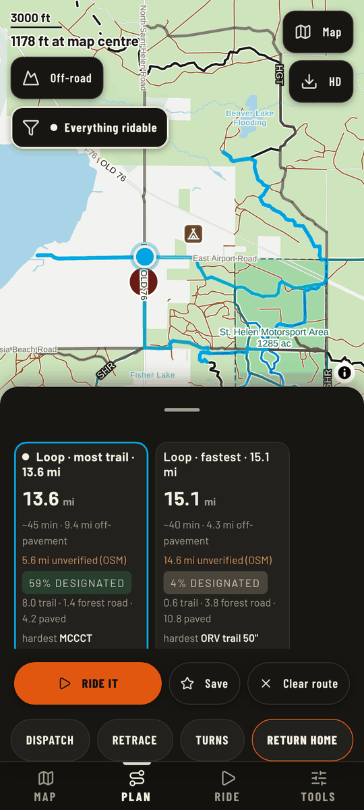

- **Six options:** Most trail, Fastest, Easiest, Pavement soonest, Shortest, Least climbing
- **Each card:** miles, time, off-pavement, % designated trail, hardest difficulty, climb profile
- **Warns** when a route passes your fuel range, runs into darkness, uses unverified OpenStreetMap miles, or leaves the network
- Never routes through closed trails
- **Loop from here:** 6–40 mi loops back to the start
- **Start from my position**, or from any pin
- **Turns:** every turn with running mileage
- **Saved:** routes and marked spots, on this phone only

## Ride it

  

- Map follows you, faces your heading and tilts; compass ribbon on top; screen stays awake
- **Turn strip:** "In 0.4 mi · Turn right onto…", miles left, arrival time
- Re-routes if you leave the line; **"You have arrived"** at the end
- **Ride sheet:** trip, to go, arrive · Stop, Re-centre, North up, Voice
- **Voice** prompts if your phone has a voice (off by default)
- **Free ride:** truck pinned at the start; **Retrace** follows your track back
- **Resume your trip?** after the app is closed mid-ride
- Ride report to copy or share; same guidance on foot

## On the water

  

- 70+ rivers ordered downstream, dams marked as portages
- **Plan a run:** tap put-in and take-out
  - Distance, dams, accesses, campgrounds on the way
  - Float time for kayak, canoe or raft/tube, calibrated to liveries' times
- **Navigate this run:** map points downstream; miles and minutes to the take-out; "Dam in 1.2 mi — portage"
- Warns if a float launched now ends after sunset
- **Live conditions** on a tap (needs signal): flow, stage, water temperature from USGS gauges

## Search

  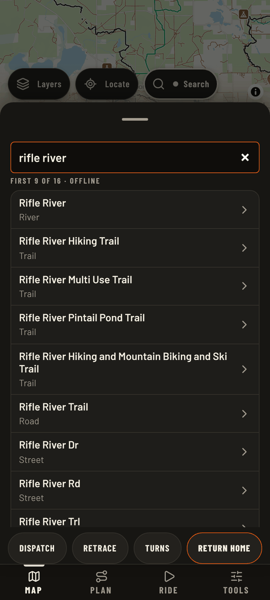

- One box, offline: trail names and numbers ("H57-17" or "h5717"), towns, junctions, ski hills, launches, rivers, streets and addresses
- A river result fits the whole river on screen and points you to the run planner

## Map, layers and imagery

  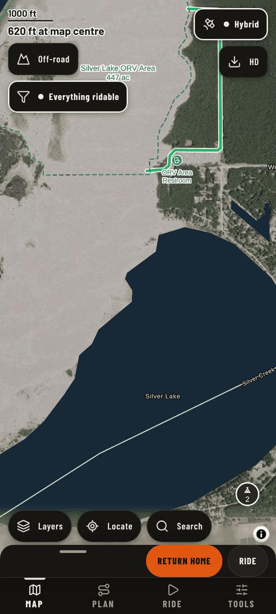
  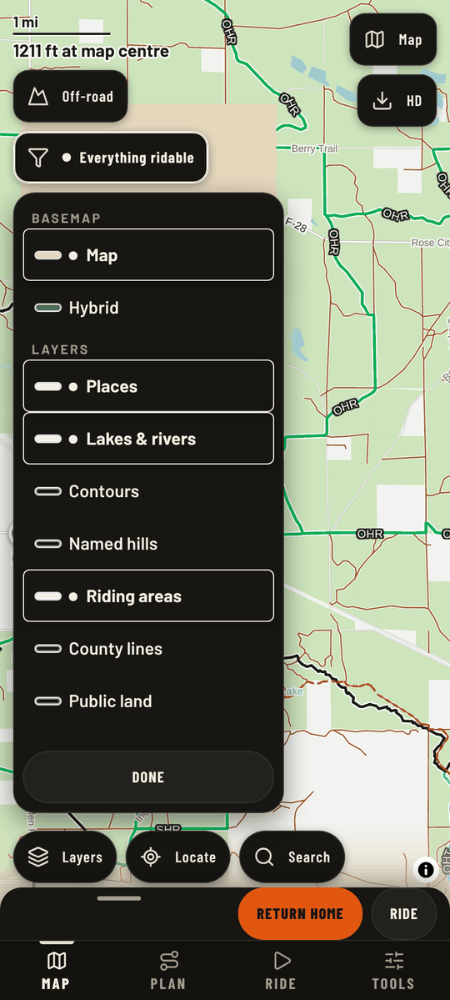
  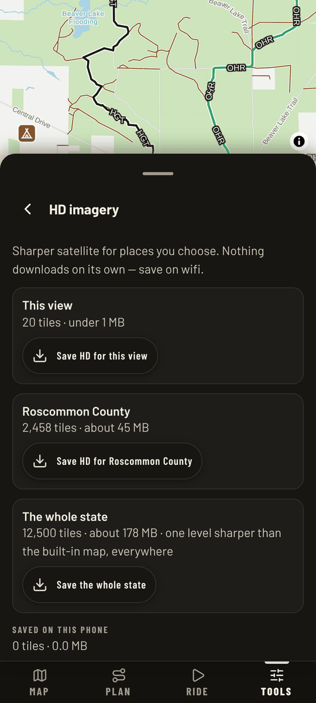

- **Map or Hybrid** in one tap; elevation at map center always shown
- **Satellite for the whole state** (USGS), sharper over riding areas
- **HD imagery:** save full detail for this view, a county or the state
  - Size quoted before saving; progress shown; resumes later
  - Nothing downloads on its own
- **Layers:** places, water, contours, named hills, riding areas, counties, public land, national forests, paddling, relief, **road hazards** (plate readers, height/weight limits, fords, rail crossings), **slope** in riding areas, map text
- **Pins per mode:** choose what each mode shows; overlapping pins stack with a count
- **Photos** on major places (Wikipedia / Wikimedia Commons), credited

## Built for the bad day

  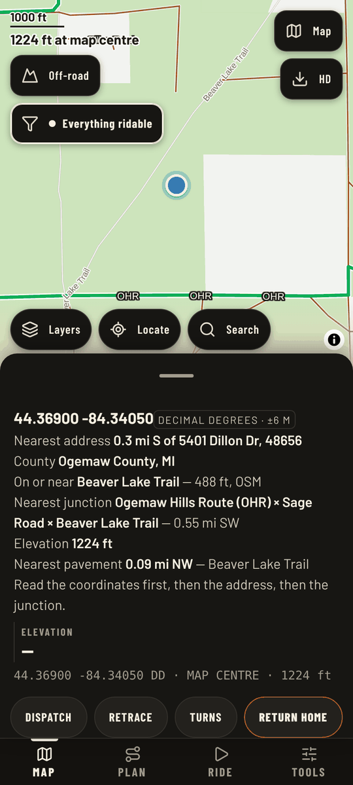
  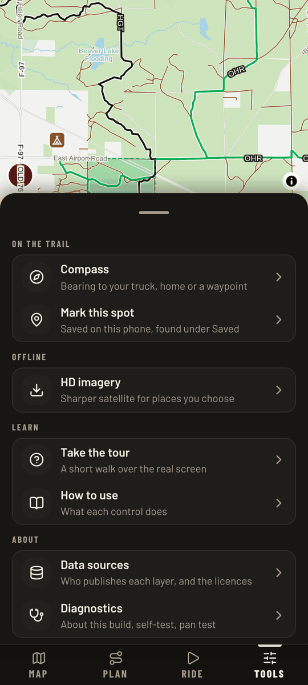

- **Dispatch:** coordinates, nearest address, county, nearest junction and pavement, to read aloud. Says when a fix is old; never guesses.
- **Compass:** bearing to your truck, home or a waypoint
- **Mark this spot**, **Retrace**, **Return home**
- **Self-test:** checks the app on your own phone
- **Tour**, **How to use**, **Data sources**

## Offline and private

- Works in airplane mode. Only HD saves and live river readings use the network, and only when you tap them.
- No account, no analytics. Everything you save stays on the phone. [Privacy policy](https://sergeantcs2.github.io/apex-site/privacy.html)

## Honest limits

- **The map is not permission.** Designations come from the DNR and Forest Service; closures can lag, and signs on the ground win.
- OpenStreetMap lines are advisory, counted as unverified.
- River miles are a floor; the paddle is longer.
- Some county and township boat ramps aren't in any public dataset yet.
- When it doesn't know (a campground type, a difficulty, a fix), it says so.

## Data and support

Data: Michigan DNR, USDA Forest Service, USGS, U.S. Census Bureau, OpenStreetMap contributors; photos from Wikipedia and Wikimedia Commons. Full list in the app under **Tools → Data sources**. APEX ORV is independent, not affiliated with any agency.

Support: the contact on the [Google Play listing](https://play.google.com/store/apps/details?id=com.apexoffroad.app) · [Privacy policy](https://sergeantcs2.github.io/apex-site/privacy.html)
